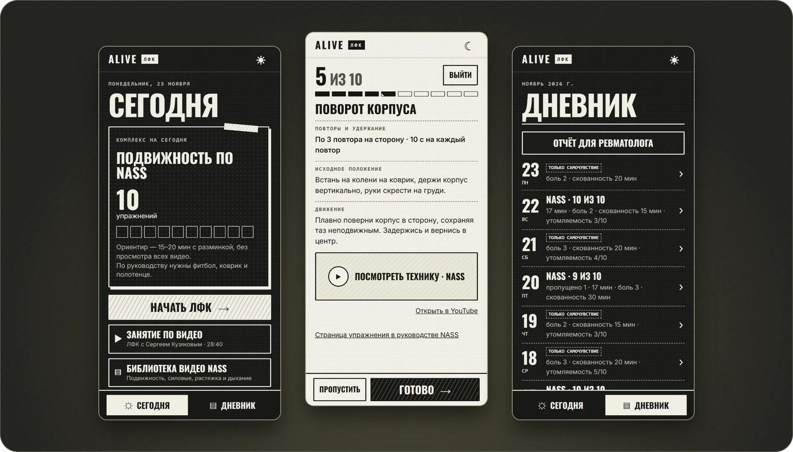
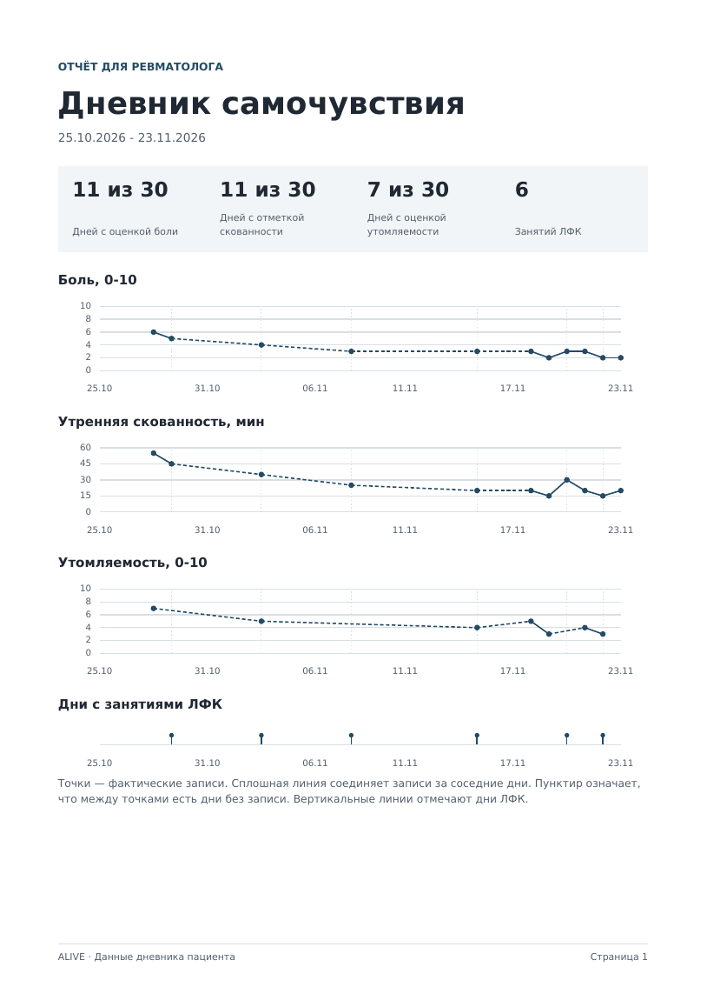

# ALIVE

**ЛФК и дневник самочувствия в Telegram**

ALIVE помогает регулярно заниматься при аксиальном спондилоартрите, отмечать симптомы и собирать историю для приёма у ревматолога.

[Запустить ALIVE](docs/operations.md) · [Пример отчёта](#отчёт-для-ревматолога) · [Документация](docs/README.md)

  

[Сегодня](docs/media/today.webp) · [Карточка упражнения](docs/media/exercise.webp) · [Дневник](docs/media/diary.webp)

*Скриншоты и пример отчёта сделаны на вымышленных данных.*

## Что умеет ALIVE

- **Проводит по комплексу NASS.** Десять упражнений на подвижность с подсказками по разминке, технике, повторам и удержанию. Видео можно открыть на каждом шаге. К незавершённому занятию можно вернуться.
- **Собирает записи в одном дневнике.** Боль и утомляемость по шкале 0–10, утренняя скованность в минутах, результаты ЛФК и заметки после занятия.
- **Напоминает в Telegram.** Утром и вечером. Из чата можно посмотреть записи за день, отметить самочувствие и перенести вечерний пинг на сегодня.
- **Показывает прогресс ЛФК за день.** Дневная цель настраивается при развёртывании. Mini App и бот показывают, сколько занятий уже сохранено.
- **Напоминает размяться после сидения.** Команда [`/wakeup`](docs/bot.md#wake-up) запускает разовый таймер. Бот присылает три коротких упражнения и сохраняет подтверждённые перерывы отдельно от ЛФК.

## Отчёт для ревматолога

PDF за выбранный период показывает динамику симптомов и дни с ЛФК. В приложении к графикам есть записи по дням, длительность занятий и заметки.

  

[Открыть пример PDF](docs/media/report-demo.pdf)

## Как устроен проект

React и Vite на клиенте, FastAPI и ReportLab на сервере. Mini App и воркер Telegram используют одну SQLite-базу. Каждое развёртывание обслуживает один настроенный профиль Telegram.

| Раздел | Содержание |
| --- | --- |
| [Архитектура](docs/architecture.md) | Компоненты, сценарий тренировки и схема развёртывания |
| [Данные и PDF](docs/data.md) | SQLite, API, авторизация и выгрузка |
| [Бот](docs/bot.md) | Команды, расписание и правила доставки |
| [Эксплуатация](docs/operations.md) | Локальный запуск, VPS, выпуск и резервное копирование |
