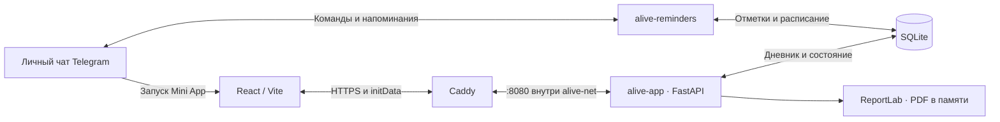

# Архитектура

ALIVE состоит из Mini App на React и Vite и двух процессов на Python 3.12. FastAPI обслуживает состояние и PDF. Отдельный процесс общается с Telegram Bot API и отправляет напоминания. Оба процесса используют один файл SQLite.

## Компоненты

| Компонент | Где смотреть | Ответственность |
| --- | --- | --- |
| Mini App | [miniapp/src](../miniapp/src) | «Сегодня», пошаговое занятие, итог, дневник, самочувствие, библиотека видео и форма отчёта |
| API | [backend/app.py](../backend/app.py) | Проверка Telegram `initData`, валидация состояния, ревизии SQLite и маршруты PDF |
| Воркер Telegram | [backend/reminders.py](../backend/reminders.py) | Long polling, частные команды, запись самочувствия, доставка и перенос напоминаний |
| Генератор отчёта | [backend/report_pdf.py](../backend/report_pdf.py) | PDF A4 с динамикой, отметками ЛФК и приложением по дням |
| Каталог | [src/lfk-spec.json](../src/lfk-spec.json) | Порядок упражнений, инструкции, ссылки на видео и материалы NASS |
| Инфраструктура | [deploy/Dockerfile](../deploy/Dockerfile), [deploy/Caddyfile](../deploy/Caddyfile) | Образ API, HTTPS и проксирование |

## Сценарий тренировки

1. «Начать ЛФК» или кнопка из `/today` открывает «Подвижность по NASS». В программе 10 упражнений из раздела *Mobility* в порядке руководства. Карточки содержат подсказку о разминке, технику, повторы и удержание, а видео открывается по запросу.
2. По завершении каждого шага Mini App сохраняет отметку «выполнено» или «пропущено». На старте сохраняется снимок порядка упражнений. После перезапуска можно вернуться к сохранённому шагу.
3. Последний шаг формирует незавершённый итог. После подтверждения в дневник записываются длительность, результаты и необязательная заметка. Запись относится к дате начала занятия. Результаты упражнений можно поправить в дневнике.
4. Занятие по видео Кузякова запускается отдельно. При сохранении можно указать фактическую длительность. Обновление страницы восстанавливает состояние занятия, а позицию в YouTube пользователь выбирает в плеере.

Тестовый комплекс остался в коде для чтения старых записей и возобновления сохранённых сессий. Если выбрать «Начать сначала», откроется NASS. Деморежим запускает NASS и использует только данные в памяти вкладки.

Каталог читается Mini App из `src/lfk-spec.json` во время сборки. [Импорт каталога в SQLite](data.md#каталог-упражнений) хранит отдельные версии справочника для разработки и анализа. Для обновления пользовательских карточек нужно пересобрать Mini App.

## Развёртывание

- В [примере развёртывания](operations.md) контейнеры работают в отдельной Docker-сети `alive-net`.
- Caddy принимает HTTPS на настроенном домене и передаёт запросы `alive-app:8080`. FastAPI отдаёт и собранный фронтенд, и API с одного адреса.
- `alive-reminders` работает независимо от HTTP-сервера и подключён к тому же каталогу данных. Он получает обновления от Telegram исходящими запросами.
